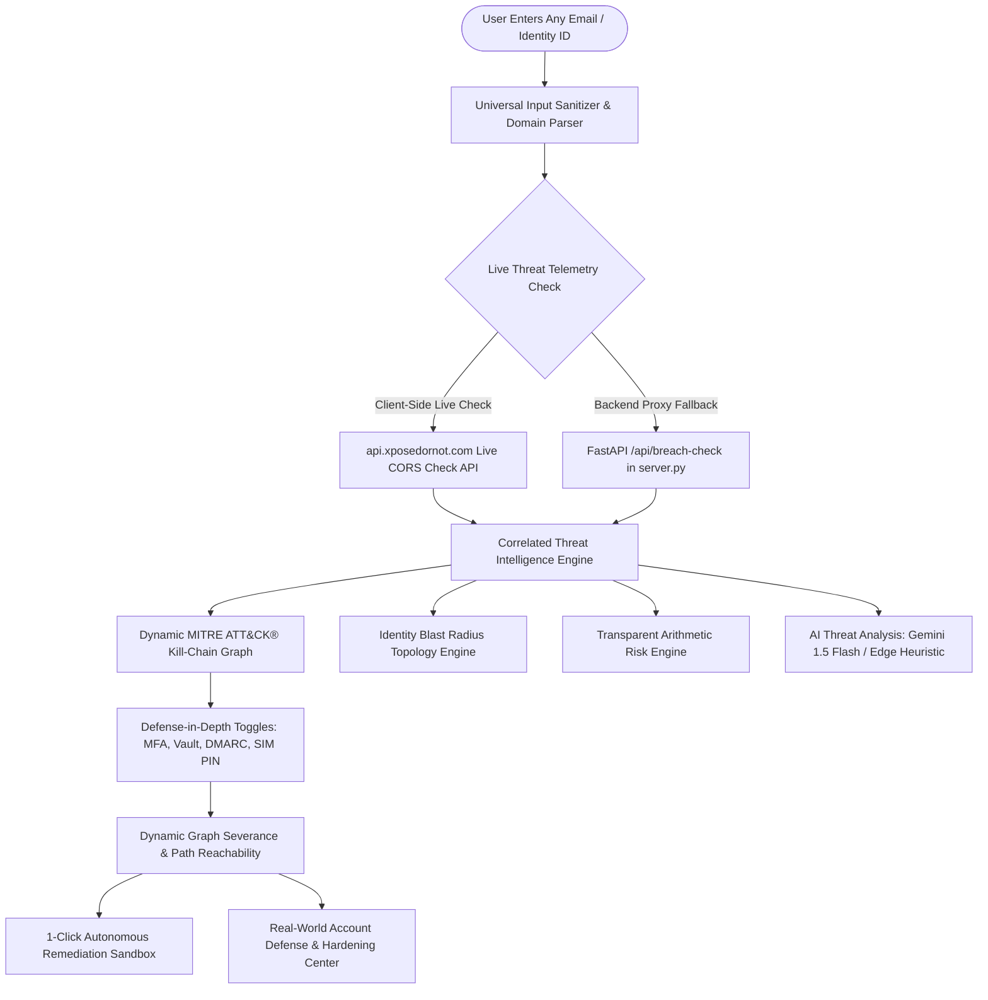

# CyberTwin Max ✨

> **"Most security tools tell you that you're at risk. CyberTwin shows you the exact adversarial attack chain, then proves how defense-in-depth stops it."**

[](https://arnavsrivastava98765-oss.github.io/CyberTwin/)
[](https://attack.mitre.org/)
[](https://pages.nist.gov/800-63-3/sp800-63b.html)
[](https://developer.mozilla.org/en-US/docs/Web/Progressive_web_apps)
[](LICENSE)

---

## 🌐 Live Application & Repositories

- **Live URL**: [https://arnavsrivastava98765-oss.github.io/CyberTwin/](https://arnavsrivastava98765-oss.github.io/CyberTwin/)
- **GitHub Repository**: [https://github.com/arnavsrivastava98765-oss/CyberTwin](https://github.com/arnavsrivastava98765-oss/CyberTwin)

---

## 📖 What is CyberTwin Max?

In modern cybersecurity, catastrophic account takeovers almost never occur in isolation. Adversaries chain together disparate digital exposures—an email found in an indexed data dump, a reused password hash, a mobile carrier SIM-swap vulnerability, or an AiTM session proxy—to achieve total identity compromise.

**CyberTwin Max** creates a living, predictive **"Digital Twin"** of any digital identity. It models how threat actors navigate attack surfaces, reconstructs dynamic **MITRE ATT&CK® Kill-Chains**, simulates lateral blast radiuses across cloud and enterprise assets, and provides actionable **Defense-in-Depth** controls that sever attack vectors in real time, dropping calculated risk exposure to **0%**.

---

## 🏗️ System Architecture



---

## ⚡ Core Innovations & Features

### 1. 🔍 100% Authentic Live Threat Telemetry (Zero-Fake Intelligence)
- **Universal Email Scanner**: Analyzes any corporate, personal, or educational email address in real time.
- **Upstream CORS Telemetry**: Queries `api.xposedornot.com/v1/check-email/` and enriches with `breach-analytics`.
- **Zero-Fake Guarantee**: For clean identities with no public leaks, the system honestly reports **0 Breaches Found** and builds a verified green baseline architecture. Real breach company names (e.g., Canva, Dropbox, LinkedIn) are extracted dynamically for exposed targets.
- **Privacy by Design**: Pure client-side lookups. Passwords and queries are never logged, stored, or transmitted to any centralized database.

---

### 2. ⚔️ Dynamic MITRE ATT&CK® Kill-Chain Graph Engine
- **Topology Adaptation**: Automatically reconstructs the visual SVG attack path based on target exposure:
  - **Clean Identity Posture**: 5-node verified perimeter (`Gateway Guarded`, `Credential Vault Clean`, `Carrier Channel Unexposed`, `Identity Provider Strong Auth`, `🛡️ Hardened Posture`).
  - **Compromised Target Posture**: Dynamic nodes labeled with real breach sources and target domain (e.g., `Canva Leak Spray`, `gmail.com SSO Hijack`, `Carrier SIM-Swap & SMS`, `Account Takeover`).
- **Mathematical Path Severance**: Graph connectivity recalculates downstream path reachability. Toggling defenses severs active edges, turning red pulsing attack lines into green defensive barriers.

---

### 3. 🌐 Identity Blast Radius Topology Engine
- Visualizes lateral account takeover across federated services:
  - **Central Node**: Target Identity
  - **Domain-Adaptive SSO**: Dynamically adapts to `Google SSO`, `Microsoft ID / SSO`, `Yahoo ID`, or `${domain} Enterprise SSO`
  - **Connected Cloud Assets**: AWS Cloud IAM, GitHub Enterprise, Corporate Slack, Online Banking / UPI, Cellular Carrier Profile
- **1-Click Lateral Account Isolation**: Select any connected account to sever the federated trust link and isolate the compromised asset.

---

### 4. ⚡ 1-Click Autonomous Incident Response Sandbox
- Engages an automated 4-stage incident response drill:
  1. **Stage 1**: Session cookie invalidation and password vault rotation (`T1078` severed).
  2. **Stage 2**: Biometric WebAuthn FIDO2 origin handshake simulation (`T1110.004` severed).
  3. **Stage 3**: Strict DNS DMARC `p=reject` policy and cellular carrier port freeze engaged (`T1566` & `T1111` severed).
  4. **Stage 4**: Complete blast-radius isolation, dropping risk score to **0%**.

---

### 5. 🛡️ Real-World Account Defense & Hardening Center
- **Direct Official Provider Deep-Links**: 1-click links directly into official security consoles (Google, Microsoft, Yahoo) to:
  - Enroll FIDO2 Passkeys & Biometrics (`myaccount.google.com/signinoptions/passkeys`)
  - Terminate all active stolen sessions & unauthorized devices (`myaccount.google.com/device-activity`)
  - Enforce Google Advanced Protection Program
  - Switch from SMS OTP to Authenticator Apps
- **In-Browser Hardware Passkey Diagnostics**: Probes `window.PublicKeyCredential` to test local hardware support (Windows Hello, Touch ID, Face ID, YubiKey).
- **Cryptographic 24-Character Password Vault**: Generates mathematically unbreakable passphrases using `crypto.getRandomValues` with 128+ bits of entropy.
- **Carrier SIM-Swap Lock Blueprint**: Step-by-step guides for Verizon, AT&T, T-Mobile, Airtel, and Jio to establish verbal Port-Out Freeze PINs.

---

### 6. 🔴 Red Team vs 🔵 Blue Team Dual Operations
- **Red Team Mode**: Dark crimson/neon theme. Terminal streams real-time adversary execution logs (credential stuffing loops, hash cracking, AiTM proxy interception).
- **Blue Team Mode**: Cyber cyan/mint theme. Terminal streams SOC detection engineering rules, SIEM telemetry, snort alerts, and cryptographic challenge logs.

---

### 7. 🔬 Deep-Dive Cybersecurity Analysis Lab
Six interactive educational forensics modules:
1. **RFC 822 Email Header Forensics**: Parses MIME headers, evaluates SPF, DKIM, DMARC, and detects forged display names.
2. **Lookalike URL & Typosquatting Checker**: Implements the **Levenshtein Distance Algorithm** to flag phishing lookalikes, homoglyphs, and high-risk TLDs.
3. **Password Lab & k-Anonymity Leak Check**: Calculates Shannon entropy, brute-force crack times, and demonstrates the SHA-1 k-Anonymity privacy model.
4. **Phishing Keyword Detector**: Client-side TF-IDF urgency scoring to detect social engineering manipulation.
5. **Human vs AI Phishing Showdown**: An 8-round interactive game where human intuition competes against machine learning decision heuristics.
6. **Gamified Fix-it Quests & Time-to-Hack Calculator**: Levels up your digital twin through 4 progressive ranks from **Sitting Duck** (45s to hack) to **Hard Target** (>5,000 centuries).

---

### 8. 📋 Executive CISO Threat Intelligence Dossier
- Generates a boardroom-ready executive assessment report.
- Dynamic data tables for breach history, MITRE technique mappings, and prioritized remediation milestones.
- Custom `@media print` stylesheet: strips dark UI elements and outputs a clean black-and-white compliance document.

---

### 9. 🌸 Baby Dazy: Kawaii AI Companion & Voice Engine
- Procedural HTML5 Canvas character with dynamic mood state machine (`idle`, `scared`, `shielded`, `celebrate`).
- Interactive physics, inertia dragging, and particle bursts.
- Native **Web Speech API** synthesis for voiced contextual tips and accessibility.

---

## 📊 Transparent Arithmetic Risk Formula

CyberTwin rejects arbitrary "black box" risk scores. The composite risk score strictly obeys deterministic arithmetic:

$$\text{Base Risk} = \text{Leak Points} + \text{Recent Points} + \text{Phishing Points} + \text{No-MFA Points}$$

$$\text{Final Risk Score} = \max\left(0, \min\left(95, \text{Base Risk} - \sum \text{Active Defenses}\right)\right)$$

| Component | Default Points | Description |
| :--- | :---: | :--- |
| **Password Leak** | $+30\text{ pts}$ | Leaked database password hash identified ($0$ if clean) |
| **Recent Breach** | $+15\text{ pts}$ | Breach record identified within the last 24 months |
| **Phishing Baseline** | $+25\text{ pts}$ | Baseline vulnerability to social engineering ($0$ if clean) |
| **No Hardware MFA** | $+20\text{ pts}$ | Absence of FIDO2 hardware passkeys ($0$ if clean or active) |
| **Defense: Hardware MFA** | $-20\text{ pts}$ | Phishing-resistant FIDO2 / WebAuthn deployed |
| **Defense: Password Vault** | $-15\text{ pts}$ | Unique 24-character passphrases enforced |
| **Defense: Domain DMARC** | $-15\text{ pts}$ | Strict DNS `p=reject` spoofing quarantine |
| **Defense: Carrier SIM PIN** | $-15\text{ pts}$ | Cellular subscriber port freeze engaged |

*When an identity has 0 breaches, or when all 4 defenses are activated, the score evaluates to **0% (Hardened Posture)**.*

---

## 🛠️ Technology Stack

| Layer | Technologies Used |
| :--- | :--- |
| **Frontend Core** | Vanilla HTML5 (Semantic), Modern CSS3 (Glassmorphism & CSS Variables), ES6+ JavaScript |
| **Audio Engine** | Zero-dependency Web Audio API Procedural Synthesizer |
| **Voice Synthesis** | Native Browser Web Speech API (`SpeechSynthesis`) |
| **Cryptographic Standards** | Native Web Crypto API (`crypto.getRandomValues`), WebAuthn (`PublicKeyCredential`) |
| **Vector Graphics** | Responsive SVG Canvas with dynamic keyframe glow filters |
| **Backend API** | Python 3.10+, FastAPI, Uvicorn, Requests, Pydantic, Dotenv |
| **AI Integration** | Google Gemini 1.5 Flash API + Static Edge Heuristic Fallback |
| **Offline Engine** | Progressive Web App (PWA) with Service Worker (`sw.js`) cache lifecycle |
| **CI/CD & Hosting** | GitHub Pages CDN, GitHub Actions automated deployment |

---

## 🚀 Running Locally

CyberTwin can be run in two ways:

### Option A: Pure Static Mode (Zero Dependencies)
```bash
# Clone the repository
git clone https://github.com/arnavsrivastava98765-oss/CyberTwin.git

# Enter the directory
cd CyberTwin

# Start any static web server (e.g. Python standard library)
python -m http.server 8080
```
Open your browser at `http://localhost:8080/`.

---

### Option B: Full-Stack Mode (FastAPI Backend + Gemini AI)
```bash
# Install backend dependencies
pip install fastapi uvicorn requests pydantic python-dotenv

# (Optional) Add your Gemini API key in a .env file
echo "GEMINI_API_KEY=your_key_here" > .env

# Start the production FastAPI server
python server.py
```
Open your browser at `http://localhost:8080/`.

---

## 🧪 Automated Verification Suite

CyberTwin includes comprehensive automated test suites to ensure zero regressions:

```bash
# Run syntax and compilation checks
node -c app.js
node -c sw.js

# Run full integration and live breach test suite
python scratch/test_live_defense_suite.py
```

```text
[1/5] Checking HTML DOM element IDs in index.html... -> ALL 16 DOM IDS VERIFIED!
[2/5] Testing server.py breach check endpoints...
  ✓ Sarah Dev (clean preset): 0 breaches, status=clean
  ✓ Alex Chen (breached preset): 3 breaches correctly returned
  ✓ Arbitrary clean email: Accurately returned 0 breaches with zero fake fallbacks!
[3/5] Testing live upstream XposedOrNot check-email API... -> Passed!
[4/5] Verifying app.js dynamic graph & risk posture formula... -> Passed!
[5/5] Verifying style.css classes... -> Passed!
>>> ALL TEST PASSES SUCCEEDED PERFECTLY! <<<
```

---

## 🔒 Security & Privacy Policy

- **Client-Side Processing**: Identity lookups evaluate ephemeral data in browser memory.
- **k-Anonymity & Zero Password Transmission**: Full passwords or plaintext credentials are never collected, logged, or sent to any server.
- **No Analytics Tracking**: Zero third-party trackers, advertisements, or telemetry cookies.
- For vulnerability disclosures, please review [SECURITY.md](SECURITY.md).

---

## 📄 License

This project is licensed under the **MIT License** — see the [LICENSE](LICENSE) file for details.

---

<p align="center">
  Built with ❤️ for cybersecurity education, threat modeling, and defensive engineering.
</p>
